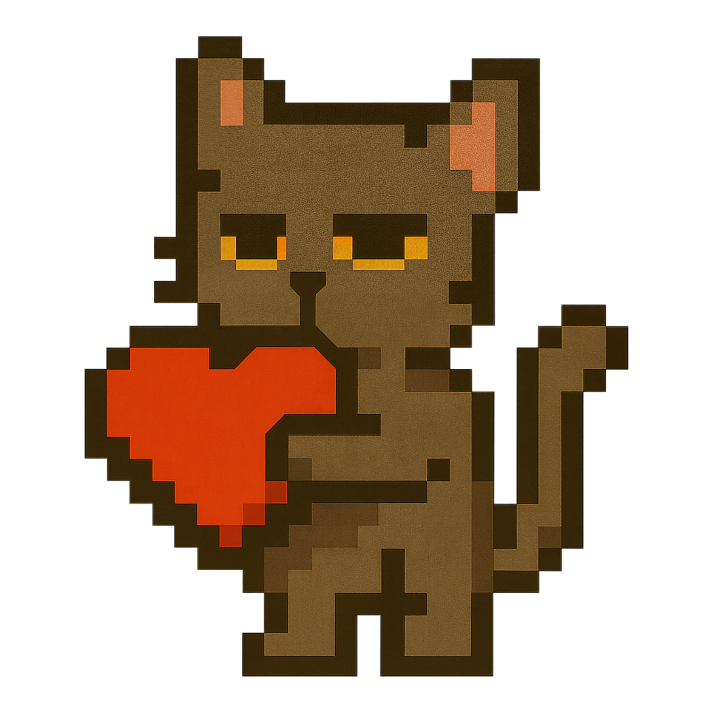
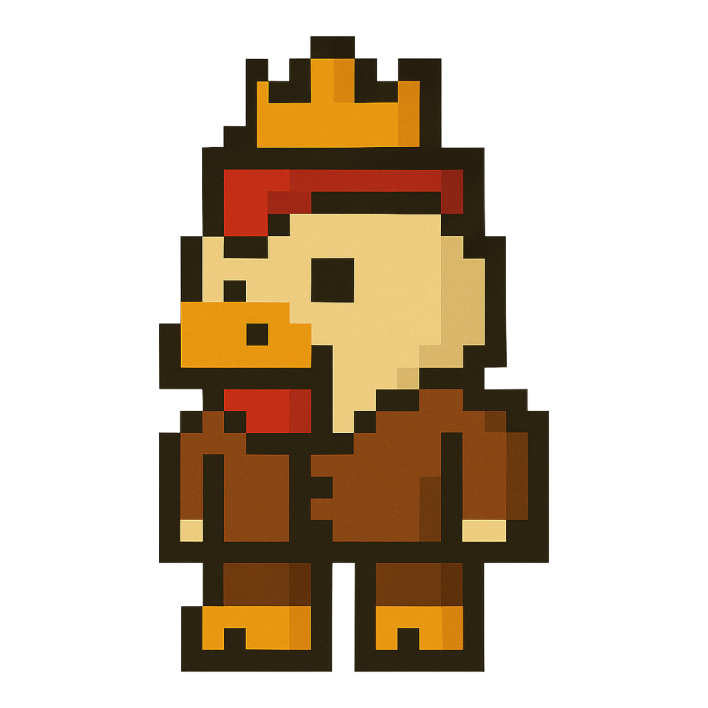
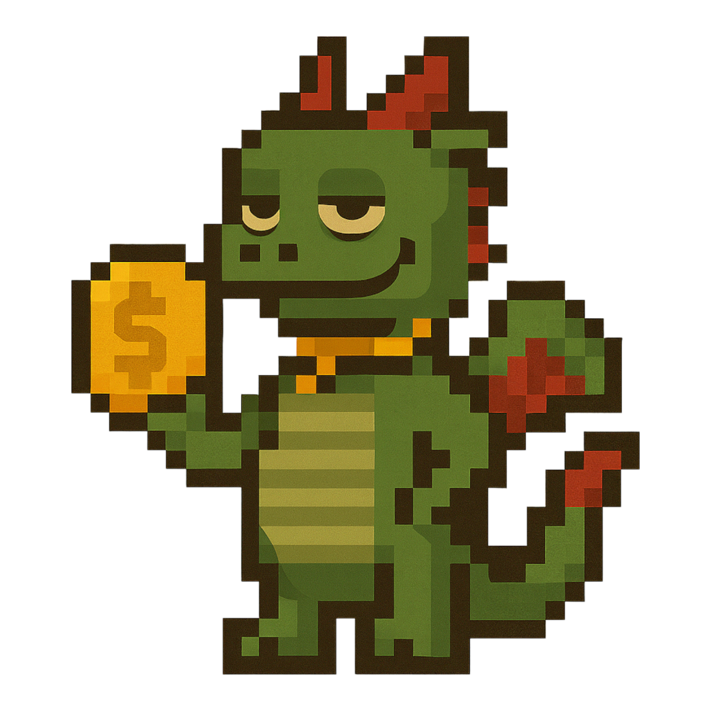
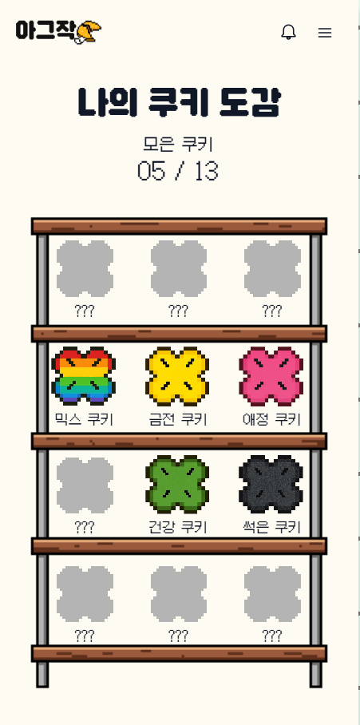
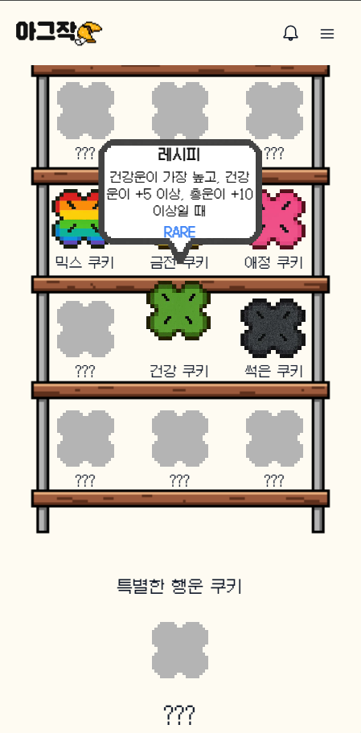
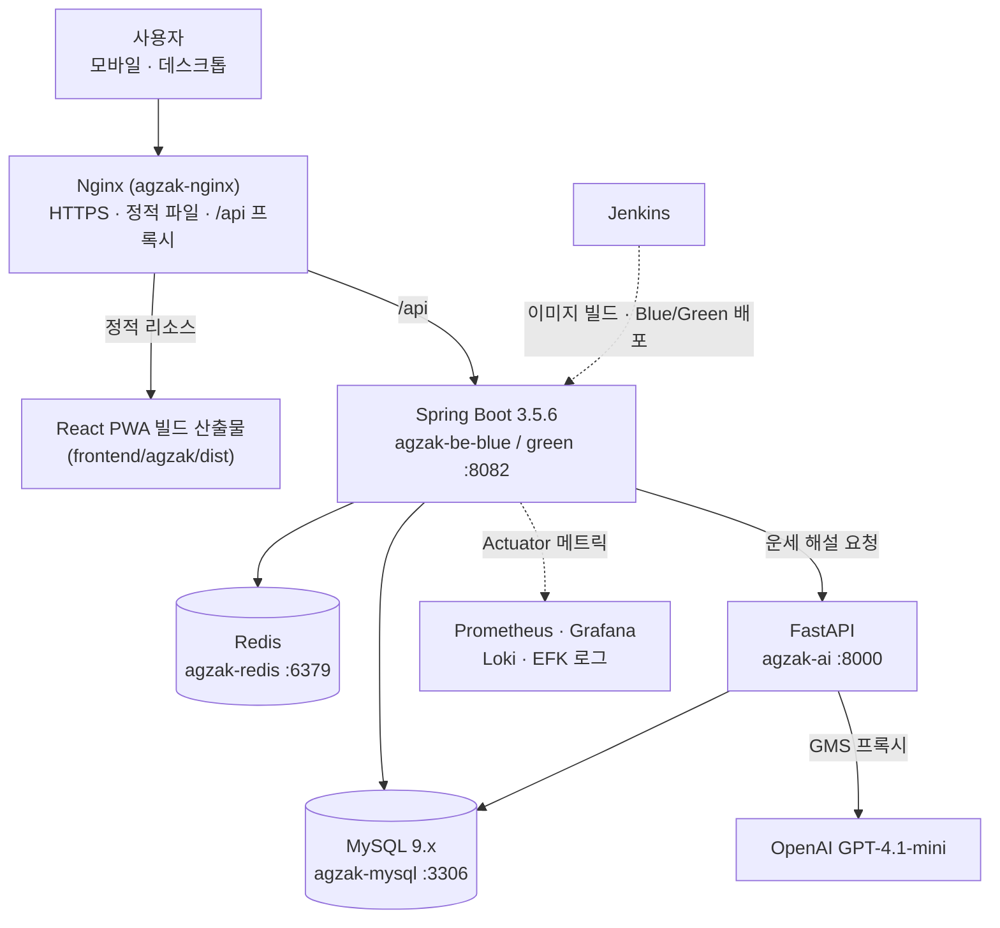
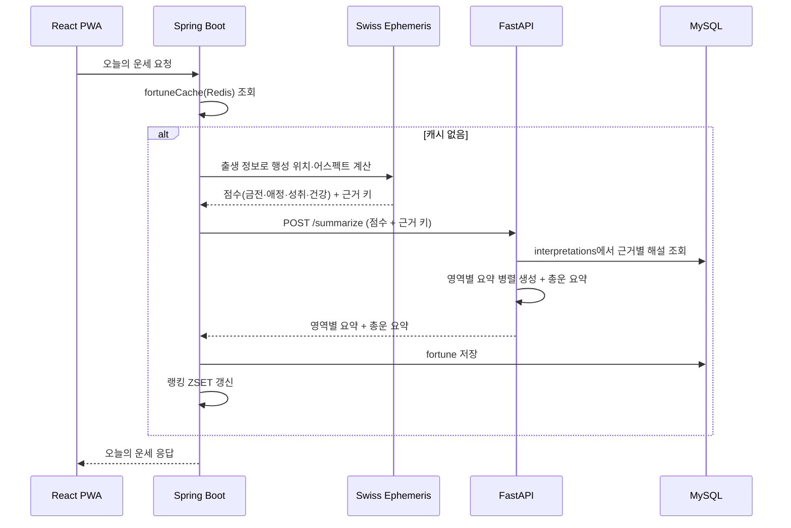
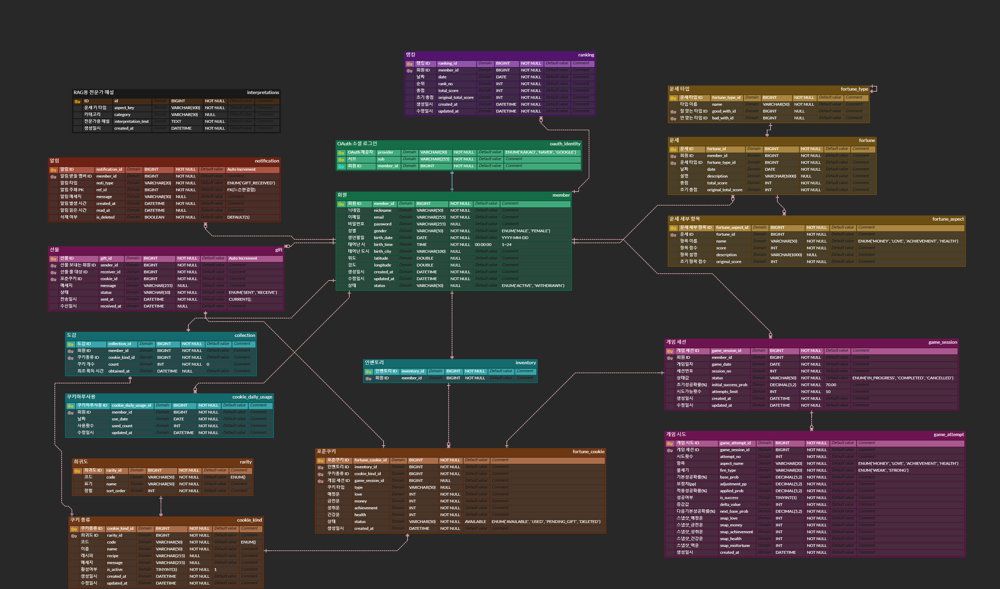

# 아그작(agzak)

<div align="center">
  <span style="display:inline-block; margin:0 4px;">
    
  </span>
  <span style="display:inline-block; margin:0 4px;">
    
  </span>
  <span style="display:inline-block; margin:0 4px;">
    
  </span>
  <span style="display:inline-block; margin:0 4px;">
    
  </span>
  <span style="display:inline-block; margin:0 4px;">
    
  </span>
  <span style="display:inline-block; margin:0 4px;">
    
  </span>
  <span style="display:inline-block; margin:0 4px;">
    
  </span>
  <span style="display:inline-block; margin:0 4px;">
    
  </span>
  <span style="display:inline-block; margin:0 4px;">
    
  </span>
  <span style="display:inline-block; margin:0 4px;">
    
  </span>
  <span style="display:inline-block; margin:0 4px;">
    
  </span>
</div>

하루 운세를 보고 끝나는 것이 아니라,  
**오늘의 운세를 “강화하고 수집하고 공유하는” 운세 경험 서비스 아그작(agzak)** 입니다.

운세 검사 및 공유, 오븐 미니게임, 포춘쿠키 수집, 포춘쿠키 선물, 운세 통계/달력, 랭킹까지 한 번에 제공합니다.

---

## 1. 프로젝트 개요

- **프로젝트명**: 아그작(agzak)
- **한 줄 설명**: AI 기반 운세 검사 + 운세 강화 게임 + 포춘쿠키 수집 서비스 + 운세 상호작용 경험(랭킹, 선물, 결과 공유)
- **진행 기간**: 2025.10.13 ~ 2025.11.20 (6주)
- **진행 형태**: SSAFY 13기 2학기 자율 프로젝트
- **팀명**: 달려라 마조리카
- **수상**: SSAFY 13기 자율 프로젝트 우수상
- **배포 주소**: https://www.agzak.co.kr

---

## 2. 목차

1. 프로젝트 개요
2. 목차
3. 프로젝트 기획 배경
4. 프로젝트 목표
5. 성과
6. 서비스명 & 로고
7. 주요 기능 & 서비스 화면
8. 홍보 및 운영 전략
9. 기술 차별점
10. 서비스 아키텍처
11. 개발 환경
12. 프로젝트 구조
13. 트러블슈팅
14. 확장 가능성
15. 추후 개선 방향
16. 협업 환경
17. 팀원 소개
18. 프로젝트 산출물
19. 회고

---

## 3. 프로젝트 기획 배경

운세 서비스는 이미 많지만 대부분 **오늘의 운세를 한 번 보고 끝나는 일회성 경험**에 그칩니다.  

- “오늘 운이 좋다더라” → 잠깐 보고 잊어버림  
- 운이 나쁘다는 결과를 보고도 부적 구입과 같은 과금 이외에는 **구체적으로 무엇을 할지 연결되지 않음**  
- 반복해서 사용할 만한 동기(게임성, 수집 요소, 통계, 상호작용)가 부족함  

아그작은 이 지점을 문제로 보고,  
**운세를 게임·수집·통계·소통과 결합해 “오늘 운세를 어떻게 활용할지”까지 연결하는 서비스**로 기획했습니다.

---

## 4. 프로젝트 목표

아그작의 궁극적인 목표는 **“운영 가능한 실서비스 수준의 운세 플랫폼”** 입니다.  
이를 위해 아래 세 가지 세부 목표를 두었습니다.

1. **실제 서비스 운영을 전제로 한 설계와 개발**
   - PWA, 반응형, 모니터링, 배포 자동화를 포함한 엔드투엔드 구성
2. **반복 사용을 유도하는 핵심 메커닉 구축**
   - 오븐 미니게임, 포춘쿠키 인벤토리, 랭킹, 통계, 선물하기 등
3. **데이터 기반 개선 사이클**
   - GA4 + Hotjar를 활용한 실제 사용자 행동 분석

---

## 5. 성과

- 2025.11.11 ~ 2025.11.24 (14일 운영, Google Analytics 4 기준)
- 총 방문자 수: **1,100명+**
- 총 가입자 수: **236명+**
- 발생한 이벤트 수: **110,000회+**
- 누적 게임 횟수: **2,319회+**
- 선착순 쿠폰 프로모션 참여 회원 수: **100명+**
- 누적 로그 수: **400,000건+**
- SSAFY 13기 자율 프로젝트 **우수상**

---

## 6. 서비스명 & 로고

<div align="center">
  
</div>

- **서비스명**: 아그작(agzak)
  - 쿠키를 한 입 베어 물 때 나는 의성어에서 착안  
  - 포춘쿠키가 “아그작 열리는 느낌”과 **게임적인 즐거움**을 함께 표현
- **메인 디자인**: 돼지 캐릭터와 네잎 클로버 모양의 포춘쿠키
  - 복(福)과 재물을 상징하는 돼지 + 네잎 클로버 = 행운과 성공을 상징
- **디자인 콘셉트**
  - 픽셀 아트 기반 레트로 게임 감성  
  - 양피지, 오븐, 쿠키 등 “오래된 마녀의 집 + 게임 아케이드” 분위기

---

## 7. 주요 기능 및 서비스 화면

### 7-1. 운세 검사

- 비로그인
  - 이름, 생년월일, 태어난 시각(모름 선택 가능)을 입력하면 오늘의 운세 제공
  - 진입 시 짧은 웹툰 인트로가 재생되고, 건너뛰기 가능
- 로그인
  - 회원 정보(태어난 지역, 생년월일, 성별)를 기반으로 원클릭 운세 검사
- 오늘의 운세 점수 + 운세 타입 + 설명 제공
- 잘 맞는 운세 타입 / 주의해야 할 타입 매칭

<div style="display: flex; justify-content: center; gap: 10px;">
  
  
  
</div>

---

### 7-2. 운세 강화 – 오븐 미니게임

- 로스트아크 돌 세공을 모티브로 한 **운세 아이템 세공 시뮬레이터**
- 하루 기본 3회, 최대 10회까지 플레이 (세션 기반 기회 관리)
  - 세션은 10번의 세공 시도로 구성되고, 10회를 마치면 포춘쿠키 1개 획득
  - 하루 허용 횟수는 `/claim` 요청으로 1회씩 늘릴 수 있고 상한은 10회
- 세공 강도(약/중/강)로 성공 확률을 조정하는 리스크 선택
  - 기본 성공 확률 70%에서 시작, 강도에 따라 ±5%p
  - 성공하면 다음 시도의 기본 확률이 10%p 내려가고, 실패하면 10%p 올라감
- 성공/실패에 따라 다섯 가지 운세(금전, 애정, 성취, 건강, 액운)가 강화/감소
  - 세션 종료 시 액운 수치는 나머지 네 운세로 재분배
- 오르거나 내린 각 운세 점수를 기준으로 **포춘쿠키 타입 결정**

<div style="display:flex; justify-content:center;">
  
</div>

---

### 7-3. 포춘쿠키 인벤토리

- 게임으로 획득한 포춘쿠키를 **최대 50개**까지 보관
  - 인벤토리가 가득 차면 가장 오래된 쿠키부터 정리
- 쿠키 사용 시 해당 일자의 운세 점수 강화 (하루 최대 50개까지 사용)
- 쿠키 삭제 / 정렬(타입, 점수 등) 기능 제공
- 쿠키 상세에서 강화 내역, 메시지 확인 가능

<div style="display:flex; justify-content:center;">
  
</div>

---

### 7-4. 쿠키 도감

- 게임으로 얻은 쿠키를 **종류별 도감**으로 수집
- 레어 · 에픽 · 유니크 · 레전더리 4단계 등급과 종류별 획득 수량 기록
- 이벤트성 쿠키(빼빼로, 산타, 럭키 등)도 도감에 포함되며, 일부는 기념 쿠키로 사용 불가
- 닉네임으로 다른 회원의 도감 조회 가능

<div style="display: flex; justify-content: center; gap: 10px;">
  
  
</div>

---

### 7-5. 운세 통계 & 달력

- 최근 7일 간의 **기본 운세 vs 강화 운세**를 히스토그램으로 시각화
- 날짜별 운세 타입/점수를 달력의 날짜를 클릭해 한눈에 확인
- 포춘쿠키 사용/강화 이력과 연동된 통계 제공

<div style="display: flex; justify-content: center; gap: 10px;">
  
  
</div>

---

### 7-6. 랭킹 & 공유

- 강화된 운세 점수를 기준으로 유저 랭킹 제공
  - 오늘 순위는 Redis에서 실시간으로 조회하고, 지난 날짜 순위는 MySQL 스냅샷으로 조회
- 랭킹 보드에서 상위 유저의 쿠키 타입/점수 확인
- 오늘의 운세/쿠키 결과를 **SNS 카드 이미지** 형태로 공유
  - 공유 링크는 24시간 만료 토큰으로 발급되어 로그인 없이도 열람 가능

<div style="display:flex; justify-content:center; gap:10px;">
  
  
</div>

---

### 7-7. 선물 & 알림

- 보유한 쿠키를 메시지와 함께 다른 유저에게 선물
  - 선물한 쿠키는 수령 전까지 `PENDING_GIFT` 상태로 보관
- 알림 사이드바를 통하여 선물 목록 확인 및 획득

<div style="display:flex; justify-content:center; gap:10px;">
  
  
  
</div>

---

### 7-8. (확장 예정 기능)

- 달성한 업적에 따른 칭호 부여  
- 액운 퇴치 모드 (유저가 설정한 “시험/발표/지출” 등 액운을 캐릭터로 퇴치)  
- 알림 기능 (일일 운세 리마인드, 친구 강화 알림)

---

## 8. 홍보 및 운영 전략

- **채널 운영**: 인스타그램 카드 이미지 중심으로 공유 확산 (GA4 유입 상위 채널: 직접 유입·인스타그램)
- **이벤트**: 선착순 쿠폰 프로모션으로 초기 유입 확보 (참여 회원 100명+)
- **데이터 기반 개선**: GA4로 유입·전환·이벤트를, Hotjar로 스크롤·클릭 패턴을 확인해 화면과 문구 개선
- **운영 리포트**: Elasticsearch 로그를 날짜별로 집계해 Notion DB에 자동 적재, 피크 시간대·에러율 확인
- **알림 연동**: Jenkins 빌드 결과와 5xx 알람을 Mattermost로 받아 장애를 바로 확인

---

## 9. 기술 차별점

1. **운세 + 게임 + 수집을 결합한 구조**  
   - 단순한 운세 조회가 아니라, 강화/수집/랭킹 구조로 재방문 유도

2. **PWA 기반 모바일 최적화**  
   - 설치형 웹앱처럼 홈 화면에서 바로 실행  
   - 주요 정적 리소스 캐싱으로 빠른 재접속

3. **도메인 기반 FE 구조**  
   - `adapters`, `lib`, `store`, `pages` 등으로 역할 분리  
   - 모든 API 호출은 `lib` 레이어를 통해서만 이루어져 유지보수에 유리

4. **데이터 기반 의사결정**  
   - GA4 + Hotjar로 페이지별 전환율, 이탈 지점, 스크롤/클릭 패턴 분석  
   - 실제 이벤트(오븐 플레이, 쿠키 사용, 공유 버튼 클릭)를 기반으로 기능 개선

5. **점성술 계산과 AI 해설의 역할 분리**
   - 출생 정보로 행성 위치·어스펙트를 계산하는 부분은 Swiss Ephemeris 기반 규칙 연산으로 처리
   - 점수는 기본 135점에서 가중치를 더하고 0~250 범위로 제한해 결정적으로 계산
   - AI는 점수를 만들지 않고, 계산에 쓰인 근거 키(`LOVE_VENUS_POSITIVE` 등)에 대한 해설만 담당
   - 해설은 `interpretations` 테이블에 미리 적재해 두고 조회(RAG)한 뒤, 영역별 요약을 병렬로 생성
   - 외부 LLM 호출은 FastAPI 게이트웨이 한 곳으로 모아 내부 호출만 사용

6. **랭킹 저장소 이원화 (Redis + MySQL)**
   - 실시간 랭킹은 Redis ZSET 3종(`rank:YYYYMMDD:total` / `original` / `gain`)으로 조회
   - 과거 순위는 MySQL `ranking` 스냅샷으로 남겨 이후 점수가 바뀌어도 흔들리지 않음
   - Redis가 비어 있거나 응답하지 않으면 MySQL 스냅샷으로 자동 대체(fallback)

7. **일일 쿼터의 멱등 처리**
   - 게임 허용 횟수는 Redis의 cap 키로 관리하고, 자정에 만료되도록 TTL을 함께 갱신
   - Redis Lua 스크립트로 증가와 멱등키 기록을 한 번에 처리해 중복 클릭·재시도에도 횟수가 한 번만 늘어남

8. **운영을 전제로 한 안전장치**
   - 스케줄러는 ShedLock으로 인스턴스가 여러 개여도 한 곳에서만 실행
   - Blue/Green 두 슬롯을 두고 `/actuator/health` 응답을 확인한 뒤 트래픽 전환
   - 운세 결과는 Redis 캐시(TTL 26시간)에 보관하고 매일 자정에 비워 날짜가 바뀌면 새로 계산

---

## 10. 서비스 아키텍처

### 10-1. 전체 구성



- 운영 환경은 AWS EC2(Ubuntu 22.04 LTS) 1대 위에 Docker Compose로 구성했습니다.
- 배포·테스트용 컨테이너는 모두 같은 `agzak-network`를 사용합니다.

### 10-2. 컨테이너 구성

| 컨테이너 | 포트 | 역할 |
| --- | --- | --- |
| `agzak-nginx` | 80, 443 | 정적 파일 서빙, `/api` 프록시, Let's Encrypt 인증서(certbot) |
| `agzak-be-blue` / `agzak-be-green` | 8082 (내부) | Spring Boot API 서버, Blue/Green 슬롯 |
| `agzak-ai` | 8000 (내부) | FastAPI 운세 해설(RAG) 게이트웨이 |
| `agzak-mysql` | 3306 | MySQL (앱 데이터 + `interpretations` 해설 테이블) |
| `agzak-redis` | 6379 | 랭킹 ZSET, 게임 쿼터, 게스트 프로필, 리프레시 토큰, 운세 캐시, ShedLock |
| `agzak-adminer` | - | DB 조회용 어드민 도구 |

### 10-3. 운세 생성 흐름



### 10-4. 데이터 모델

<div align="center">
  
</div>

- **회원·인증**: `member`, `oauth_identity`
- **운세**: `fortune`, `fortune_aspect`, `fortune_type`
- **게임·쿠키**: `game_session`, `game_attempt`, `inventory`, `fortune_cookie`, `cookie_kind`, `rarity`, `cookie_daily_usage`
- **수집·소셜**: `collection`, `gift`, `notification`
- **랭킹**: `ranking`
- **이벤트·쿠폰**: `event_types`, `events`, `coupon_types`, `coupons`, `member_coupons`
- **AI 해설**: `interpretations`

DDL/DML은 `backend/src/main/resources/agzak_ddl.sql`, `agzak_dml.sql`에 있고, `exec/DB/`에도 같은 스크립트와 ERD 이미지가 있습니다.

---

## 11. 개발 환경

### 11-1. 기술 스택

| 구분 | 사용 기술 |
| --- | --- |
| **Backend** | Java 17, Spring Boot 3.5.6, Spring Web, Spring Data JPA, Spring Security, OAuth2 Client, Spring Data Redis, QueryDSL 5.0.0, JJWT 0.11.5, ShedLock 5.15.1, springdoc-openapi 2.8.13, Micrometer(Prometheus), Logback + Logstash encoder, Swiss Ephemeris 2.01, Gradle |
| **Database / Cache** | MySQL 9.x, Redis |
| **AI** | Python 3.11, FastAPI 0.111.0, Uvicorn 0.29.0, aiomysql 0.2.0, OpenAI 1.x (SSAFY GMS 프록시), pydantic-settings 2.2.1 |
| **Frontend** | React 19, TypeScript 5.9, Vite 7, Zustand 5, React Router 7, Tailwind CSS 4, Radix UI, Recharts 2.15, vite-plugin-pwa 1.1, GA4, Hotjar |
| **Infra / CI** | Ubuntu 22.04 LTS, Docker Engine 24+, Docker Compose v2, Jenkins(Blue/Green), Nginx + Certbot, AWS EC2, Prometheus · Grafana · Loki |

### 11-2. 환경 변수

실제 값은 저장소에 두지 않고 실행 환경에서 주입합니다. 아래는 필요한 키 목록입니다.

```bash
# backend (Spring Boot)
SPRING_PROFILES_ACTIVE=prod
SPRING_PORT=8082
MYSQL_HOST=<mysql-host>
MYSQL_PORT=3306
MYSQL_DATABASE=agzak
MYSQL_USER=<db-user>
MYSQL_PASSWORD=<db-password>
REDIS_HOST=<redis-host>
REDIS_PORT=6379
JWT_SECRET=<jwt-secret>
JWT_ISSUER=<issuer>
ACCESS_EXP_MINUTES=60
REFRESH_EXP_DAYS=14
GMS_API_KEY=<gms-api-key>
GPT_MODEL=gpt-4.1-mini
AI_GATEWAY_URL=http://agzak-ai:8000
KAKAO_REST_KEY=<kakao-rest-key>
KAKAO_JS_KEY=<kakao-js-key>
SHARE_LINK_SECRET=<share-link-secret>
LOG_FILE_PATH=/var/log/agzak
LOG_FILE_NAME=agzak-app-server
```

```bash
# ai (FastAPI)
DB_HOST=<mysql-host>
DB_PORT=3306
DB_USER=<db-user>
DB_PASSWORD=<db-password>
DB_NAME=agzak
GMS_API_KEY=<gms-api-key>
GMS_BASE_URL=<gms-base-url>
GMS_MODEL=gpt-4.1-mini
SERVER_HOST=0.0.0.0
SERVER_PORT=8000
```

```bash
# frontend (Vite)
VITE_API_BASE_URL=https://www.agzak.co.kr/api/v1
VITE_KAKAO_LOGIN_JS_KEY=<kakao-js-key>
VITE_GA_ID=<ga4-measurement-id>
VITE_HJ_ID=<hotjar-site-id>
VITE_ENABLE_ANALYTICS=true
```

### 11-3. 로컬 실행

```bash
# 1) DB / Redis
cd infra
make set-up      # agzak-network 생성
make up-local    # mysql, redis, adminer 기동

# 2) 백엔드
cd backend
./gradlew bootRun --args='--spring.profiles.active=dev'

# 3) AI 서버
cd ai
pip install -r requirements.txt
uvicorn Ai_Fortune:app --host 0.0.0.0 --port 8000

# 4) 프론트엔드
cd frontend/agzak
npm ci
npm run dev      # http://localhost:5173
```

- 백엔드 API 문서: `/api/swagger-ui.html`
- 헬스 체크: `/actuator/health`

---

## 12. 프로젝트 구조

```text
.
├── backend/                        # Spring Boot API 서버
│   ├── src/main/java/com/ssafy/agzak
│   │   ├── domain/                 # auth · member · fortune · game · inventory
│   │   │                           # gift · ranking · coupon · event · collection
│   │   │                           # share · notification · guest
│   │   ├── global/                 # security(JWT) · scheduler · time · tx · aspect · error
│   │   ├── config/                 # Security · JPA/QueryDSL · Redis Cache · ShedLock · Swagger
│   │   └── docs/                   # 도메인별 Swagger 문서 인터페이스
│   ├── src/main/resources/         # application-{dev,prod,test}.yml, DDL/DML
│   │                               # cities.json, ephe(천문 데이터), logback-spring.xml
│   ├── libs/                       # swisseph-2.01.00-02.jar
│   └── build.gradle
│
├── ai/                             # FastAPI 운세 해설 서버
│   ├── Ai_Fortune.py               # /summarize 엔드포인트
│   ├── populate_rag_db.py          # interpretations 테이블 시드 적재
│   ├── config.py                   # 환경 변수 설정
│   └── Dockerfile
│
├── frontend/
│   ├── agzak/                      # React + TypeScript + Vite (PWA)
│   │   ├── src/
│   │   │   ├── adapters/           # 서버 응답 → 화면 모델 변환
│   │   │   ├── app/                # 라우터, 레이아웃, 프로바이더
│   │   │   ├── components/         # atoms · molecules · organisms · template · ui
│   │   │   ├── hooks/ · lib/       # API 클라이언트, 분석 도구
│   │   │   ├── pages/              # Home · Fortune · Enforce · Cookies · Calendar · Auth · My
│   │   │   ├── pwa/ · store/       # PWA 등록, Zustand 스토어
│   │   │   └── types/
│   │   └── public/                 # 아이콘, manifest.webmanifest
│   ├── card/                       # 12지신 카드 이미지
│   └── logo.png
│
├── infra/                          # 배포 구성
│   ├── db/                         # agzak-mysql.yml · agzak-redis.yml
│   ├── backend/                    # agzak-app-server.yml · ci/Jenkinsfile
│   ├── frontend/ci/                # Jenkinsfile (빌드 후 dist 배포)
│   ├── infra/                      # nginx.yml(+certbot) · agzak-adminer.yml
│   └── Makefile                    # 네트워크 생성, 스택 기동/종료, 로그
│
├── exec/                           # 산출물
│   ├── DB/                         # agzak_ddl.sql · agzak_dml.sql · agzak_ERD.png
│   ├── images/                     # 서비스 화면 캡처
│   ├── 포팅 매뉴얼.md
│   └── 시연시나리오.md
│
└── scripts/                        # 커밋 메시지 규칙 점검 스크립트
```

---

## 13. 트러블슈팅

### 13-1. 심야 스케줄러 데드락

| 구분 | 내용 |
| --- | --- |
| 증상 | 운영 중 매일 자정 직후 5xx 응답과 InnoDB Deadlock(SQLState 40001) 알람 발생 |
| 원인 | 23:59에 몰린 스케줄러 작업이 Blue/Green 두 컨테이너에서 동시에 실행되며 같은 행을 갱신 |
| 해결 | ShedLock(Redis)으로 스케줄러를 단일 실행으로 제한하고, 랭킹 작업을 매시간 단위로 분할 |
| 결과 | 적용 후 자정 데드락 알람 재발 0건, 스냅샷 누락도 발생하지 않음 |

발견 경로는 Mattermost 5xx 알람이었고, 알람에서 추적한 로그로 원인을 확인했습니다. 지금은 랭킹 스냅샷(매시 59분 55초)과 리씨드(매시 55분) 모두 같은 방식으로 잠금을 겁니다.

### 13-2. 랭킹 조회 구조 개선

| 구분 | 이전 | 이후 |
| --- | --- | --- |
| 오늘 TOP 조회 | 매 요청 `ORDER BY` 풀스캔 + 정렬 | Redis ZSET `ZREVRANGE` 단건 |
| 내 등수 조회 | 별도 카운트 쿼리로 재정렬 | `ZREVRANK` 한 번 |
| 과거 일자 순위 | Fortune 갱신 시 어제 순위가 흔들림 | MySQL `ranking` 스냅샷으로 보존 |
| 운영 지표 | 슬로우 쿼리 확인 | 운영 기간 슬로우 쿼리 0건 유지 |

실시간성과 과거 보존은 같은 자료구조로 만족시키기 어려워 저장소를 나눴습니다. Redis가 비었을 때는 MySQL 데이터로 다시 채우고(reseed), 탈퇴 회원은 스냅샷 생성 시 정리합니다.

### 13-3. AI 해설 호출 지연과 연결 끊김

| 구분 | 내용 |
| --- | --- |
| 증상 | 운세 조회 시 응답이 늦어지고, 외부 LLM 호출 구간에서 연결이 끊기는 요청 발생 |
| 원인 | 백엔드가 LLM 호출을 직접 들고 있으면 응답 시간이 그대로 요청 시간이 되고, 호출 실패 시 복구 지점이 없음 |
| 해결 | LLM 호출을 FastAPI 게이트웨이로 분리하고, 해설은 DB(RAG)에서 조회 후 영역별 요약만 병렬 생성. 백엔드는 3회 재시도와 실패 시 대체 문구로 응답 |
| 결과 | 요청당 대기 시간이 줄고, LLM 장애가 운세 조회 전체 실패로 이어지지 않음 |

---

## 14. 확장 가능성

- 운세 타입/쿠키 타입을 확장한 **시즌제 이벤트**  
- 기업/브랜드 협업 쿠키(스폰서 쿠키, 한정판 쿠키) 연계  
- 유저 맞춤형 푸시/이메일 알림 기반 리텐션 마케팅을 위한 앱 출시

---

## 15. 추후 개선 방향

- **액운 퇴치 모드·업적/칭호**: 기획만 정리된 상태로, 게임 규칙과 화면 설계를 마친 뒤 순차 적용 필요
- **알림**: 현재는 사이드바에서 목록을 조회하는 방식이며, 웹 푸시/앱 푸시는 미구현
- **게임 밸런스 외부화**: 성공 확률(70%), 확률 변동(±10%p), 등급 결정 규칙이 코드 상수로 들어 있어 운영하며 조정하기 어려움 → 설정 테이블/관리 API로 분리
- **랭킹 동기화 방식**: 매시간 배치(리씨드·스냅샷)에 의존하므로, 이벤트 기반 갱신이나 지연을 줄이는 구조 검토
- **테스트 범위**: 쿠폰·쿠키 사용 쪽 단위 테스트만 있고, 게임 세션·랭킹·선물 동시성에 대한 테스트는 부족
- **보안 검증 자동화**: JWT 재발급·블랙리스트 방어를 코드로 넣었지만, 시나리오 기반 회귀 테스트로 효과를 증명하지는 못함
- **부하 테스트**: 실제 트래픽은 2주 운영으로 확인했으나, 목표 동시 접속 기준의 부하 테스트는 미실시

---

## 16. 협업 환경

| 구분 | 내용 |
| --- | --- |
| 형상 관리 | GitLab(SSAFY)에서 개발 후 GitHub로 이관, `master`·`develop`·`develop-be`·`feature-be/*` 브랜치 운영 |
| 코드 리뷰 | GitLab MR 템플릿(`.gitlab/merge_request_templates/default.md`)으로 변경 요약·확인 사항 정리 |
| 커밋 규칙 | `scripts/convention/lint-commit-msg-config.sh`로 커밋 메시지 형식 점검 |
| API 문서 | springdoc-openapi + Swagger UI(`/api/swagger-ui.html`)로 요청·응답 명세 공유 |
| 빌드 알림 | Jenkins 파이프라인 결과를 Mattermost로 전송 |
| 운영 기록 | 일별 로그 집계를 Notion DB에 적재해 회고에 사용 |

---

## 17. 팀원 소개

총 6명 (Backend 2 · Frontend 3 · Infra 1)으로 진행했습니다.

| 역할 | 인원 | 담당 |
| --- | --- | --- |
| Backend | 2 | 인증/보안(OAuth2·JWT 재발급), 운세 계산·AI 연동, 게임 쿼터·멱등 처리, 랭킹 이원화, 쿠키·도감·선물 API |
| Frontend | 3 | 운세·강화·도감·캘린더 화면, PWA 구성, 공유 카드, 상태 관리 |
| Infra | 1 | Docker Compose 스택, Jenkins Blue/Green 배포, Nginx·인증서, 모니터링 |

---

## 18. 프로젝트 산출물

| 산출물 | 위치 |
| --- | --- |
| 요구사항·기능 정의 | `exec/` 문서 |
| ERD | `exec/DB/agzak_ERD.png` |
| DB 스크립트 | `exec/DB/agzak_ddl.sql`, `exec/DB/agzak_dml.sql` |
| API 명세 | Swagger UI (`/api/swagger-ui.html`) |
| 포팅 매뉴얼 | `exec/포팅 매뉴얼.md` |
| 시연 시나리오 | `exec/시연시나리오.md` |
| 서비스 화면 캡처 | `exec/images/` |
| 발표 자료 | 최종 발표 PPT는 저장소에 포함하지 않았습니다 |

---

## 19. 회고

- **실제 트래픽을 받아본 첫 경험**  
  14일 동안 방문자 1,100명, 이벤트 11만 건을 받으며 “안전하다고 말하는 것”과 “수치로 보여주는 것”의 차이를 배웠습니다.

- **환경이 만드는 장애를 진단**  
  자정 스케줄러 데드락은 코드 한 줄이 아니라 실행 환경(다중 인스턴스 + 동시 cron)에서 나온 문제였습니다. ShedLock과 시간 분할로 막은 뒤에는 같은 문제가 재발하지 않았습니다.

- **같은 단어 안의 다른 요구를 분리**  
  “랭킹” 하나에도 실시간성과 과거 보존이라는 다른 요구가 있었고, 저장소를 나누는 판단으로 풀었습니다.

- **멱등성은 기능이 아니라 정합성의 도구**  
  게임 일일 횟수에 멱등키를 넣어 더블 클릭·재시도에도 횟수가 한 번만 늘도록 했습니다.

- **모니터링은 질문하는 사람이 살아 있게 한다**  
  대시보드를 매일 보며 어떤 수치가 위험한지 판단하는 습관을 들였고, 다음에는 알람 기준을 문서로 남기려 합니다.
